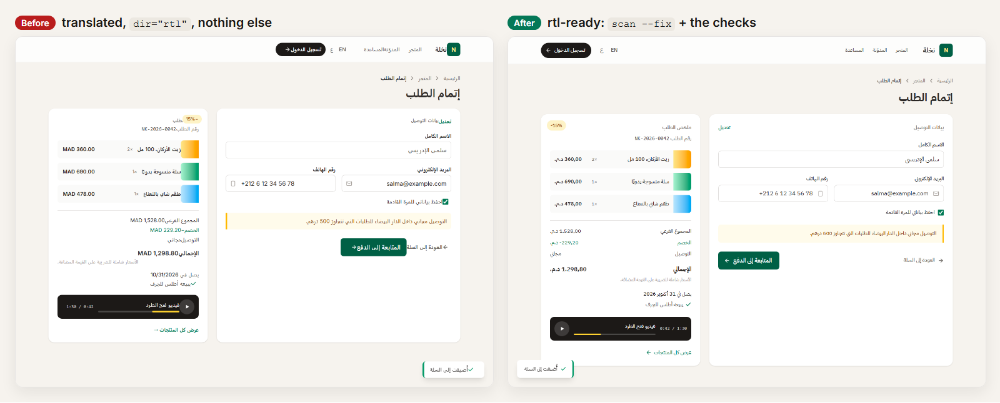
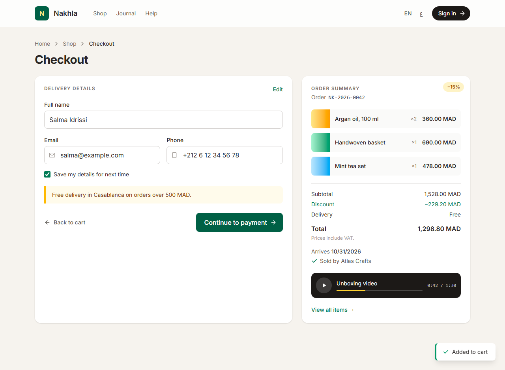
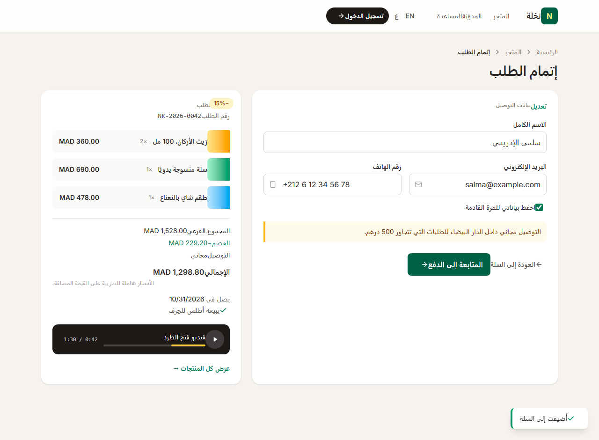
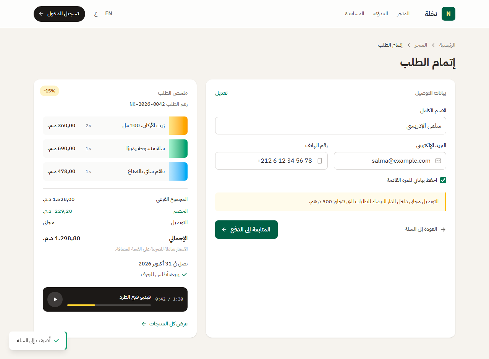

# rtl-ready

**Make any web app ready for right-to-left languages (Arabic, Hebrew, Persian, Urdu) with one Claude Code skill.**

[](https://github.com/miraya-dev/rtl-ready/actions/workflows/test.yml)
[](LICENSE)


Translating the strings and adding `dir="rtl"` is the easy 10%. rtl-ready finds and fixes the
rest:
- margins and icons on the wrong side, and arrows that point backwards
- scrambled phone numbers
- Arabic letters torn apart by letter-spacing
- prices and dates in the wrong format



**Live demo:** [rtl-ready.vercel.app](https://rtl-ready.vercel.app) shows the same page before and
after, in English and Arabic.

> **بالعربية:** مهارة مفتوحة المصدر لـ Claude Code تفحص تطبيق الويب، وتصلح ما يتعطّل عند الكتابة من
> اليمين إلى اليسار، ثم ترشد Claude إلى الباقي: الأيقونات، والأرقام والبريد الإلكتروني، والخطوط
> العربية، وتنسيق الأسعار والتواريخ.

## What you get

1. **An audit with file:line.** `scan.mjs` is a zero-dependency Node script. It finds
   physical-direction code in Tailwind classes, CSS, `<style>` blocks, inline styles, React style
   objects and CSS-in-JS, and prints the logical replacement for each finding.
2. **Safe automatic fixes.** `--fix` rewrites only drop-in replacements, such as `ml-4` → `ms-4`,
   `margin-left` → `margin-inline-start`, `text-left` → `text-start` and
   `float: right` → `float: inline-end`.
3. **Guidance for the judgment calls.** The skill walks Claude through what a regex can't decide:
   - `dir`/`lang` per locale
   - which icons to mirror (and which never to)
   - LTR islands for phone numbers, emails, URLs and code
   - bidi isolation and Arabic typography
   - `Intl` number and date formatting
   - forms, animations and component libraries

## Before → after, for real

`examples/before/` is a checkout page written LTR-first, the way most apps start. It only flips
`dir` for Arabic. This is what the skill did to it:

```console
$ node skills/rtl-ready/scripts/scan.mjs examples/before
rtl-ready: 76 findings in 1 of 1 files · 57 fix · 15 check · 4 tip

examples/before/index.html:2:1      check  <html>  no lang: set it per locale …                 html-lang
examples/before/index.html:18:9     fix    float: right → float: inline-end                       css-physical
examples/before/index.html:39:24    fix    ml-3 → ms-3                                            tw-physical
examples/before/index.html:51:25    check  icon-arrow-right  directional icon: mirror it in RTL …  icon-mirror
examples/before/index.html:83:17    check  <input type="email" …>  emails, phone numbers and URLs are LTR …  input-ltr
examples/before/index.html:117:33   fix    right-4 → end-4                                        tw-physical
examples/before/index.html:185:77   tip    .toLocaleDateString()  pass the active locale …       intl-locale
…

$ node skills/rtl-ready/scripts/scan.mjs examples/after --fix    # on a copy of before/
rtl-ready: applied 57 safe fixes.
rtl-ready: 19 findings in 1 of 1 files · 0 fix · 15 check · 4 tip
```

The 19 remaining checks were then handled by hand, following the skill:
- mirror the arrows and chevrons, but not the play button or the checkmarks
- make the email and phone fields LTR
- `<bdi>` around the order number
- an Arabic font, line-height, and no letter-spacing for Arabic
- `Intl` for the prices (`ar-MA` → `1.298,80 د.م.`) and the date
- a `--dir` variable for the toast animation

The page now scans clean:

```console
$ node skills/rtl-ready/scripts/scan.mjs examples/after
rtl-ready: 1 file scanned, no RTL issues found ✓
```

| | English (LTR) | Arabic (RTL) |
|---|---|---|
| **Before** |  |  |
| **After** |  |  |

The full scan outputs are in [docs/scan-before.txt](docs/scan-before.txt) and
[docs/scan-after-fix.txt](docs/scan-after-fix.txt).

## Install

### As a Claude Code plugin (recommended)

In Claude Code:

```text
/plugin marketplace add miraya-dev/rtl-ready
/plugin install rtl-ready@rtl-ready
```

Or from a shell:

```bash
claude plugin marketplace add miraya-dev/rtl-ready
claude plugin install rtl-ready@rtl-ready
```

Claude uses the skill on its own when you talk about RTL, Arabic, Hebrew and so on. You can also
call it directly with `/rtl-ready:rtl-ready`. To update later, run
`/plugin marketplace update rtl-ready`.

### Manually, as a personal skill

```bash
git clone https://github.com/miraya-dev/rtl-ready.git
cp -r rtl-ready/skills/rtl-ready ~/.claude/skills/
```

On Windows (PowerShell):
`Copy-Item -Recurse rtl-ready\skills\rtl-ready "$HOME\.claude\skills\"`.

Call it with `/rtl-ready`. To share it with a team, copy it into the project's
`.claude/skills/rtl-ready/` instead and commit it.

### Just the scanner

`skills/rtl-ready/scripts/scan.mjs` is a single file that needs only Node 18.17+:

```bash
node scan.mjs src            # audit
node scan.mjs src --fix      # apply the safe fixes
node scan.mjs src --json     # machine-readable
```

## Usage

Ask in plain words:

- "Add Arabic to this app and make the layout RTL-ready."
- "Our Hebrew pages look broken. Audit `src/` and fix the RTL issues."
- "Run rtl-ready on the checkout flow only. Apply the safe fixes and list what needs my decision."
- "Set `dir` and `lang` per locale with next-intl."
- "Review this branch for RTL regressions."

The skill's workflow:
1. Learn the stack.
2. Scan.
3. `--fix` the mechanical part.
4. Work through each `check` with the matching reference.
5. Cover a checklist of things no scanner sees.
6. Verify in both directions and report what is left for you to decide.

## How it works

```text
skills/rtl-ready/
├── SKILL.md                 lean workflow + rules of thumb + checklist
├── scripts/scan.mjs         the scanner (zero dependencies)
└── references/              read only when needed (progressive disclosure)
    ├── logical-css.md       CSS, Tailwind v3/v4 and Bootstrap mappings; what to leave alone
    ├── mirroring.md         icons, transforms, animations, scrollLeft, keyboard, carousels
    ├── bidi-text.md         LTR islands, <bdi>, dir="auto", Intl, digits, forms
    ├── typography.md        Arabic/Hebrew/Persian/Urdu fonts, line-height, letter-spacing
    └── i18n-wiring.md       dir/lang with next-intl, i18next, Vue, SvelteKit, Astro; component libraries
```

### What the scanner reports

| Level | Rule | Finds |
|---|---|---|
| fix | `tw-physical` | `ml-` `mr-` `pl-` `pr-` `left-` `right-` `text-left` `float-right` `border-l` `rounded-r` `rounded-tl` `scroll-ml`…, with variants, `!` and negatives |
| fix | `css-physical` | `margin-left`, `padding-right`, `left:`, `border-left-*`, corner radii, `text-align`, `float`, `clear`, asymmetric `margin: 0 8px 0 0` |
| fix | `js-style` | `marginLeft`, `paddingRight`, `textAlign: "left"`, `left:` in `style={{…}}` |
| fix | `bs-physical` | Bootstrap 3/4 `pull-right`, `rounded-left`, `border-right-0` |
| check | `icon-mirror`, `arrow-glyph` | arrow/chevron components and icon-font classes without `rtl:-scale-x-100`; `→` `←` in text |
| check | `tw-translate`, `css-translate`, `tw-gradient`, `tw-origin` | horizontal motion, gradients and transform origins that don't flip |
| check | `input-ltr` | email, phone and URL inputs without `dir="ltr"` |
| check | `html-dir`, `html-lang` | `<html>` without `dir`/`lang` |
| check | `css-rtl-override`, `tw-space-x` | `[dir=rtl]` overrides to delete; `space-x-reverse` (and v3 `space-x`) |
| tip | `letter-spacing`, `intl-locale` | tracking on text that may be Arabic; `toLocaleString()` without a locale |

It also knows what to leave alone:
- symmetric utilities (`mx-`, `inset-x-0`)
- centring (`left-1/2 -translate-x-1/2`)
- `rtl:`/`ltr:` variants, and Radix `data-[side=left]:` variants
- `[dir=rtl]` rules and comments
- TypeScript types like `{ left: number }`

Options:
- `--min fix|check|tip`
- `--ignore <path-part>`
- `--tailwind 3|4` (read from `package.json` by default)
- `--exit-zero`

Exit codes: 1 when fix/check findings remain (useful in CI), 2 on usage errors.

To silence a line, add a comment that contains `rtl-ready-ignore`. `rtl-ready-ignore-next-line` and
`rtl-ready-ignore-file` work too. Say why in the comment.

## Limitations

- **Heuristic, not a full parser.** The scanner uses careful regexes. It misses classes built at
  runtime (`` `ml-${n}` ``), styles assembled across files, and custom Tailwind plugins. Run it,
  then let the skill's checklist cover the rest.
- **Icons are found by name.** Inline `<svg>` without a telling class, images, canvas and charts are
  not detected. The checklist asks Claude to look.
- **`--fix` is deliberately narrow.** Transforms, icons, inputs, typography and `[dir=rtl]`
  overrides always stay for review.
- **Bootstrap 5** compiles its logical names to physical CSS, so RTL pages also need
  `bootstrap.rtl.min.css`.
- **HTML emails** keep physical properties, because many email clients ignore logical ones.
  Silence those files.
- **Web only.** React Native, Flutter and native apps have their own RTL systems.
- It does not translate your strings.

## Contributing

Issues and pull requests are welcome, especially from people who read Arabic, Hebrew, Persian or
Urdu every day. See [CONTRIBUTING.md](CONTRIBUTING.md). Tests run with `npm test` (`node --test`),
and nothing needs to be installed.

## License

[MIT](LICENSE) © 2026 Moncef El hirech (Miraya)

---

Built by [**Miraya**](https://miraya-web-el-mo-dev1.vercel.app), an Arabic-first product studio.
The demo shop, its products and its people are fictional.
